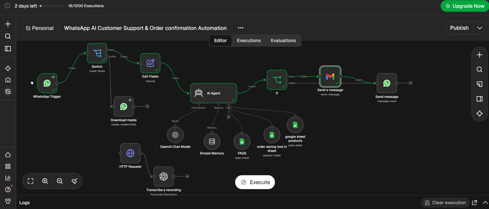
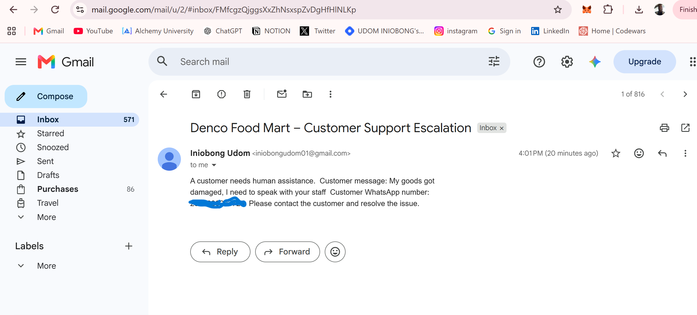
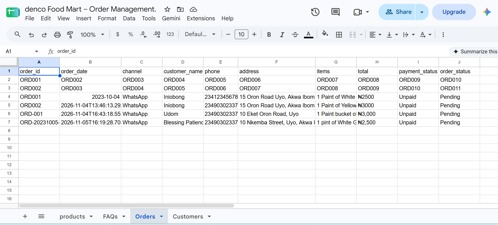

# WhatsApp AI Customer Support & Order Management Automation

An AI-powered WhatsApp customer support and order management system built with **n8n** for the Denco Food Mart case study.

The workflow handles routine customer enquiries, looks up products and FAQs, captures confirmed orders in Google Sheets, and escalates complaints or requests for a human representative to staff by email.

> **Project status:** The text-based customer support, order-handling, and human-escalation paths have been tested. Voice-note processing is not included as a working feature.

## Business problem

Food businesses receive repetitive questions about products, prices, availability, and orders through WhatsApp. Manual handling can slow responses and make it harder to keep order details organised. This project demonstrates how an AI-assisted workflow can handle routine interactions while routing sensitive cases to a human.

## Key features

- **WhatsApp support:** receives customer text messages and sends replies.
- **Product enquiries:** retrieves product information from Google Sheets.
- **FAQs:** answers common business questions using an FAQ sheet.
- **Order collection:** gathers order details and requests customer confirmation.
- **Order records:** saves confirmed orders to Google Sheets.
- **Human escalation:** detects complaints and explicit requests to speak with staff, sends an email notification, and acknowledges the customer on WhatsApp.
- **Conversation context:** uses n8n Simple Memory to maintain short-term context.

## Workflow architecture

1. **WhatsApp Trigger** receives the incoming message.
2. **Switch** routes the message by type; the documented working path is text.
3. **Edit Fields** prepares the customer message.
4. **AI Agent** processes the request using the connected model, memory, product lookup, FAQ lookup, and order-saving tools.
5. **IF** checks for the internal `STAFF_ESCALATION` marker.
6. **Escalation path:** Gmail sends the staff notification, then WhatsApp sends the customer acknowledgement.
7. **Normal path:** WhatsApp sends the AI response directly.

See [Workflow overview](docs/workflow-overview.md) for the detailed flow.

## Workflow screenshots

### n8n workflow

### Human escalation email

### Google Sheets order record

## Technology

- **n8n** — workflow orchestration
- **WhatsApp Cloud API** — customer messaging
- **OpenAI Chat Model via n8n AI Gateway** — language understanding and response generation
- **Google Sheets** — product catalogue, FAQs, and order records
- **Gmail** — human-escalation notifications

## Google Sheets structure

The workbook is organised around these tabs:

| Sheet | Purpose |
|---|---|
| Products | Product names, prices, and availability |
| FAQs | Approved answers to common questions |
| Orders | Confirmed orders and order status |
| Customers | Customer information used for order management |

Only publish a sanitised demo workbook. Do not expose real customer details.

## Human escalation

The agent should immediately escalate when a customer asks to speak with a human/staff member or reports an issue such as damaged goods, missing items, or an incorrect order.

The workflow uses `STAFF_ESCALATION` as an internal routing marker. The marker is removed from the WhatsApp message shown to the customer.

Before production use, configure Gmail to notify the business's approved support inbox and test the email notification and WhatsApp acknowledgement together.

## Demo

- **Loom walkthrough:** Add the public Loom share link here when supplied.

## Setup overview

This repository documents the implementation; it intentionally does **not** include the exported n8n workflow JSON or credentials.

To recreate the workflow:

1. Build/import the workflow in your own n8n workspace.
2. Configure your own WhatsApp Cloud API and Meta app credentials.
3. Connect an OpenAI / n8n AI Gateway credential.
4. Connect Google Sheets and map the required workbook tabs and columns.
5. Connect Gmail and set the approved staff notification address.
6. Test product enquiries, confirmed order saving, staff requests, and complaints before publishing.

## Security

- Never commit API tokens, Meta app secrets, OAuth credentials, or credential exports.
- Remove personal customer information from screenshots and sample data.
- Use test accounts and test numbers during development.
- Rotate any credential that is accidentally exposed.

## Scope and limitations

- The tested path documented here is text-based WhatsApp support.
- Voice-note download/transcription nodes exist in the workflow draft but are not confirmed working; voice support is not claimed.
- Payment verification, live inventory synchronisation, delivery tracking, and a dedicated staff dashboard are outside the current implementation.
- This is a demonstrator and needs business-specific configuration and testing before production use.

## Author

**Iniobong Udom** · [GitHub](https://github.com/IniobongUdom7)
